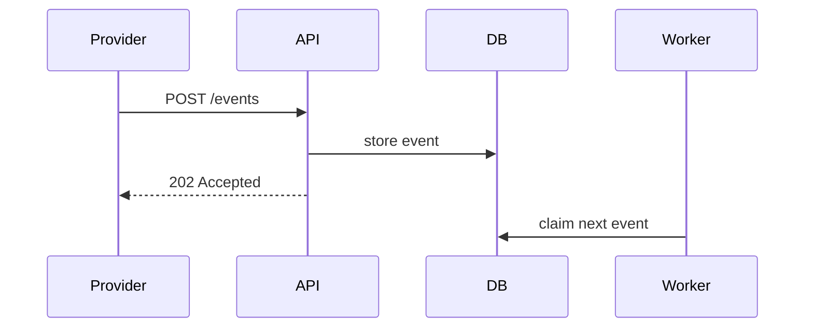

# Long-lived documentation

**Reader:** someone months from now who needs to learn, do, look up, or understand something, with nobody to ask.

**Budget:** past 1,000 words a page needs a summary and a table of contents. How-to guide 200 to 800 words; tutorial up
to about 2,000 with a visible result at each step; ADR one to two pages; mini design doc one to three pages, a large one
ten to twenty; runbook entry one screen.

## Pick one type per page

Never mix these on one page; link between them instead.

| Type | Reader need | Must | Must not | Title shape |
| --- | --- | --- | --- | --- |
| Tutorial | Learn by doing | Show a visible result at every step | Explain at length or offer choices | "Build your first X" |
| How-to guide | Reach a goal, already competent | Ordered actions toward the goal | Teach or list every option | "How to integrate X" |
| Reference | Look up facts while working | Neutral, consistent structure mirroring the product | Instruct or give opinions | The item's name |
| Explanation | Understand why | Context, reasons, alternatives | Steps or reference detail | "About X" |

**Visuals by type:** tutorials show screenshots of the expected result; how-to guides use numbered steps and code
blocks; reference uses tables; explanation is where diagrams earn their place most.

## Design doc

**Shape:** context and scope; goals and non-goals; design, overview first, then a context diagram, interfaces, and
storage; alternatives considered, with why each lost; cross-cutting concerns such as security and migration. Skip the
doc when the problem has no real tradeoff.

````markdown
## Alternatives considered

| Option | Latency | Ops cost | Why not |
|---|---|---|---|
| Poll every 5 s | 2.5 s avg | none | Wastes 17 k queries per minute at idle |
| **Webhook push** | 0.3 s avg | one endpoint | Chosen |
| Message queue | 0.2 s avg | new cluster | No team owns a queue today |


````

## Architecture decision record

**Shape:** numbered title; status (proposed, accepted, superseded by ADR N); context as facts; the decision as "We
will..."; every consequence, not just the good ones. One decision per record; supersede instead of editing an accepted
one. Write full sentences.

```markdown
# ADR 7: Use PostgreSQL logical replication for the reporting replica

Status: Accepted (2026-11-07). Supersedes ADR 3.

## Context
Reporting queries run on the primary and slow checkout by up to 300 ms at
month end. The team knows PostgreSQL well and has no Kafka experience. Reports
may be at most 5 minutes stale.

## Decision
We will stream the orders and invoices tables to a separate reporting database
with PostgreSQL logical replication.

## Consequences
Month-end reports no longer touch the primary. Every migration on a replicated
table now needs a matching change on the replica. If other consumers later need
events, this will not cover them and a new ADR will be needed.
```

## Runbook entry

**Shape:** what the alert means; impact and severity; how to check; how to mitigate, with commands to copy; when to
escalate; when it was last verified. If the entry is a fixed list of commands, automate it instead.

````markdown
## Alert: CheckoutErrorRateHigh

**Means:** more than 1% of checkout requests return 5xx for 5 minutes.
**Impact:** customers cannot pay. Severity: SEV-2.

### Check
1. Open the [checkout dashboard](https://grafana.example.com/d/checkout).
2. If errors cluster on one pod, it is a bad pod; otherwise go to step 3.
3. Count gateway timeouts; more than 50 means the gateway is the cause:
   ```sh
   kubectl -n pay logs deploy/gateway --since=10m | grep -c timeout
   ```

### Mitigate
| Cause | Action |
|---|---|
| Bad pod | `kubectl -n shop delete pod <name>` |
| Gateway timeouts | `featurectl set pay.fallback on` |
| Recent deploy | `deployctl rollback checkout` |

### Escalate
Not resolved in 20 minutes: page payments on-call.

_Last verified: 2026-10-30 by @maria_
````

## Postmortem

**Shape:** summary, impact, root causes, trigger, resolution, detection; an action-item table with owners; what went
well, what went wrong, where we got lucky; a timestamped timeline. Blameless: name systems and decisions, never a
person's fault.

```markdown
| Action | Type | Owner | Ticket |
|---|---|---|---|
| Alert on replica lag above 60 s | Detect | @leo | OPS-610 |
| Add a migration check for replicated tables | Prevent | @ana | OPS-611 |
```

**Sources:** [Diátaxis](https://diataxis.fr/),
[Design docs at Google](https://www.industrialempathy.com/posts/design-docs-at-google/),
[ADR templates](https://github.com/joelparkerhenderson/architecture-decision-record), [adr.github.io](https://adr.github.io/),
[Google SRE postmortem culture](https://sre.google/sre-book/postmortem-culture/).
