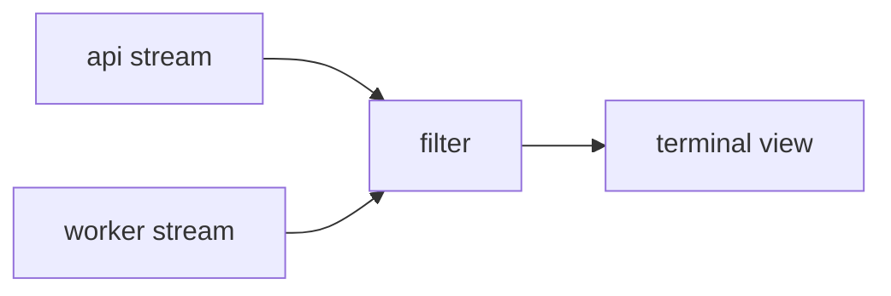

# README

**Reader:** someone who just landed on the repository and asks: what is it, is it for me, how do I install and use it,
where do I get help.

**Budget:** one-line description under 120 characters; opening of at most 50 words; quickstart of at most five
commands; 300 to 1,500 words in total. Add a table of contents once it passes 100 lines; move anything longer to a docs
site and link it.

**Shape:**

1. Title, then the one-line description on its own line.
2. One screenshot, GIF, or terminal recording showing it working.
3. Install, as a code block.
4. Usage, as a code block, plus an options table when there are flags.
5. Links out to how-to guides, reference, and design notes.
6. Contributing and license, license last.

**Visuals that earn their place:** a demo image near the top with alt text; an options or comparison table; a small
Mermaid diagram only when the project has several components; `<picture>` for light and dark variants.

**Avoid:** an opening about the project's history, a wall of badges, images of code, "simply", no install or usage
block, no license.

## Example

Bad opening:

> Welcome to Larkspur! This project was started in 2023 as an experiment in making log tailing more pleasant...

Good:

````markdown
# larkspur

Tail and filter JSON logs from many services in one terminal view.


## Install

```sh
cargo install larkspur
```

## Usage

```sh
larkspur --service api --service worker --filter 'level=error'
```

| Flag | What it does | Default |
|---|---|---|
| `--service` | Service to follow; repeatable | all |
| `--filter` | jq-style predicate | none |

More: [How-to guides](docs/how-to/) · [Reference](docs/reference.md) · [Design notes](docs/explanation.md)

## Contributing

See [CONTRIBUTING.md](CONTRIBUTING.md).

## License

MIT
````

When components matter, one small diagram beats a paragraph:

````markdown

````

**Sources:** [standard-readme](https://github.com/RichardLitt/standard-readme/blob/main/spec.md),
[Make a README](https://www.makeareadme.com/), [ripgrep README](https://github.com/BurntSushi/ripgrep/blob/master/README.md).
