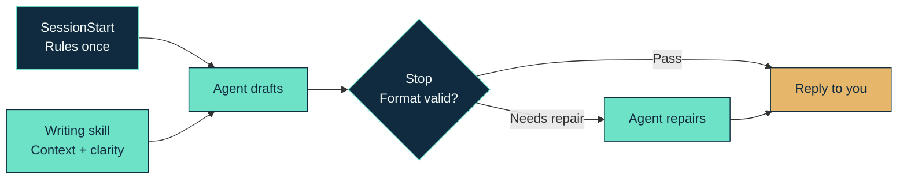

<!-- markdownlint-disable MD033 MD041 -->

<div align="center">


# Wellput

**Your agents work in parallel. Your attention doesn’t.**

[](https://github.com/Castrozan/wellput/actions/workflows/verify.yml)
[](LICENSE)
[](#install)

</div>

<!-- markdownlint-enable MD033 MD041 -->

Wellput is a **hook and a writing skill** that make end-of-turn replies easier to **understand and act on**. Recognize the session, see what got done, know whether you’re needed, and move on without rereading the full conversation.

> Built for **free sessions**: high-stakes discovery and delivery, not predefined workflows.

The point isn’t just _shorter replies_. It’s putting the responsibility for making work understandable on the agent, so you can work across dozens of sessions without having to give each one your full attention.


[Watch the narrated tour](https://github.com/user-attachments/assets/70519b32-bcfe-4e2d-b427-6a866af8dd38)

## Install

Requires Python 3.12+ as `python3`. Runtime dependencies are bundled.

### Claude Code

```text
/plugin marketplace add Castrozan/wellput
/plugin install wellput@wellput
```

### Codex

```sh
codex plugin marketplace add Castrozan/wellput
codex plugin add wellput@wellput
```

Review and trust the hooks when prompted, then start a new session.

## How it works

**The agent has the context. You shouldn’t have to rebuild it.**

The end-of-turn reply may be all you read. It should make the work understandable without sending you back through the conversation.

**The skill guides the writing. The hook enforces the format.**



## The reply format

**A confirmation shouldn’t become a report. Longer replies should bring you back into the session.**

| #   | Reply  | Prose budget                      | Ending                     |
| --- | ------ | --------------------------------- | -------------------------- |
| 1   | Short  | 100 words + 10 words of grace     | No required labels         |
| 2   | Longer | Separate body and closing budgets | Three closing blocks below |

| #   | Closing block                    | What you get                                                         |
| --- | -------------------------------- | -------------------------------------------------------------------- |
| 1   | **What is this session about?:** | The session’s subject and goal, beyond the latest step.              |
| 2   | **Done:**                        | What actually changed or was established.                            |
| 3   | **Next:**                        | Remaining work, blockers, or confirmation that the work is finished. |

Bold labels, consistent order, and independent word budgets keep the summary easy to find.

**Sometimes the clearest paragraph is a diff.** For an exact change in `release.yaml`:

```diff
- retry_limit: 10
+ retry_limit: 3
```

Use tables, diagrams, and code when they save the reader work. Visuals and fenced code don’t count toward the prose budget.

### Other rules

| #   | Check            | What it gives you                                                              |
| --- | ---------------- | ------------------------------------------------------------------------------ |
| 1   | Lists and tables | At most 5 items or data rows; numbered table rows for replies like “about #2.” |
| 2   | Navigation       | Direct links to referenced PRs and MRs.                                        |
| 3   | Opening          | The answer first, without reactions or narration.                              |
| 4   | Punctuation      | No em or en dashes outside quotes; configurable.                               |

## Configure

**No configuration needed to start.** Bundled defaults apply until you provide your own.

| #   | When                                | Configuration file                                  |
| --- | ----------------------------------- | --------------------------------------------------- |
| 1   | `WELLPUT_CONFIG` is set             | Its absolute path; overrides the default locations. |
| 2   | Otherwise, `XDG_CONFIG_HOME` is set | `$XDG_CONFIG_HOME/wellput/config.json`              |
| 3   | Otherwise                           | `~/.config/wellput/config.json`                     |

Copy `wellput.json` to the applicable path, then change budgets, labels, checks, or repair feedback. Use a complete file; configurations aren’t merged. Restart the session after editing.

## License

Wellput is [MIT licensed](LICENSE). Bundled Markdown dependencies retain their own [licenses](hooks/vendor/licenses).
