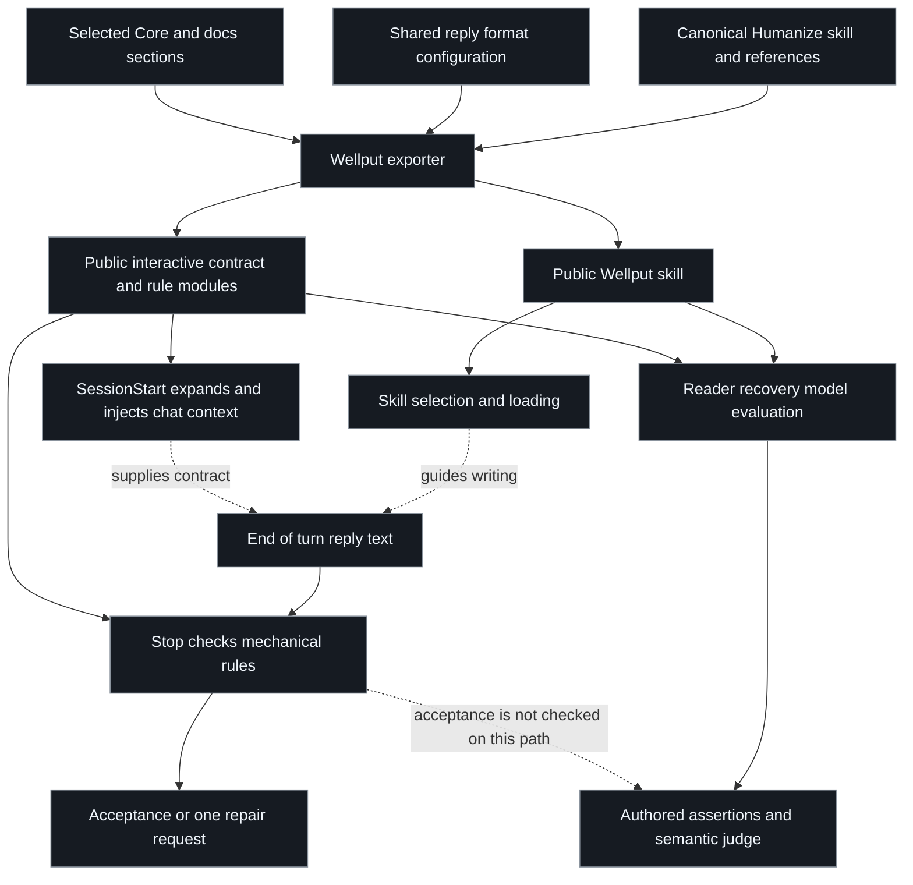

# Wellput: relationships, precedence, and ownership

[Audit overview](../skill-audit.md). This is a proposed refinement analysis of the source snapshots named there; it does not add policy.

## What is actually assembled

The separate paths are intentional: deterministic code owns exact syntax, while language guidance owns meaning and representation suitability. The missing integration is a test of both on the same finished reply. The injected contract is conditional on the harness actually running the trusted hook. A manifest and a successful subprocess prove configuration and output, not installed runtime delivery.

## Overlap does not always mean removable duplication

| #   | Cluster             | Sentence and section relationships                                                                                                                                                       | Consolidation boundary                                                                                                                                      |
| --- | ------------------- | ---------------------------------------------------------------------------------------------------------------------------------------------------------------------------------------- | ----------------------------------------------------------------------------------------------------------------------------------------------------------- |
| 1   | Reader context      | S2 states the objective; S3 lists success properties; S8 restates independence from history; S64 repeats the inventory for artifacts.                                                    | Keep one task-dependent reader contract. Retain artifact-specific audience and lifespan, not another generic context list.                                  |
| 2   | Terminology         | S9 preserves names; S10 checks established terms; S12 protects precision; S35 forwards to fidelity; S36-S39 repeat selection, definition, stability, and exactness.                      | One owner can retain all distinct operations. S37's concrete definition and S38's stability are not redundant merely because nearby preservation rules are. |
| 3   | Missing information | S14 resolves ambiguous references; S15 exposes unknowns; S28 states missing evidence; S34 controls consequential clarification.                                                          | Separate how uncertainty is communicated from whether the agent investigates, asks, or stops.                                                               |
| 4   | Recovery            | S6 triggers inspection; S29 diagnoses failure; S30 supplies a repair; S31 protects accepted vocabulary; S32-S33 explain superficial repair; S62 repeats the fallback.                    | Keep the trigger, diagnosis boundary, and concrete repair. Merge repeated warnings about relabeling, and preserve the operational-anger control.            |
| 5   | Representation      | S18 chooses a form; S22 repeats diff selection; S23 repeats tree selection; S52 adds lists.                                                                                              | Choose once, then explain how to render the selected form. Do not move semantic suitability into a word-count regex.                                        |
| 6   | Information order   | S1 identifies the question; S20 puts visuals first; S27 puts an action first; S46 puts the paragraph point first; S53 starts with answer/known context.                                  | Set one priority order with room for a visual that itself carries the answer. Local rendering rules must not silently override the user's decision.         |
| 7   | Procedures          | S48 orders prerequisites; S49 orders warnings; S50 repeats the rationale; S51 keeps required actions in steps; S63 checks the procedure using only those steps.                          | This is complementary procedural guidance. Removing S50's duplicate rationale is different from removing the completeness check.                            |
| 8   | Register            | S55 adapts expertise; S56 preserves voice and nuance; S57 removes filler; S58 blocks artificial rhetoric; S59 repeats empty-reassurance concerns; S60 has an undefined revision trigger. | Keep a positive target and specific failure conditions. Preserve meaning-bearing contrasts and requested headings.                                          |
| 9   | Revision            | S61 repeats fidelity, reader recovery, representation, terminology, and filler inventories.                                                                                              | An ordered self-check adds value; copied definitions need not become a second authority. A self-check is not verification evidence.                         |
| 10  | Persistent delivery | S66 states injection, S67 forbids ordinary reloading, and S68 routes link style; the reference supplies format and broader operational defaults.                                         | Bind no-reload to actual context presence. Keep harness mechanics and consumer preferences outside semantic writing rules.                                  |

## Cross-surface conflicts and missing arbitration

| #   | Case                                | Competing instructions                                                                                      | Observed result or precise uncertainty                                                                                                                                       |
| --- | ----------------------------------- | ----------------------------------------------------------------------------------------------------------- | ---------------------------------------------------------------------------------------------------------------------------------------------------------------------------- |
| 1   | Reply with exactly `Absolutely`     | S11's requested-artifact fidelity versus the reaction-opener pattern.                                       | Stop blocks the exact answer. Adding a qualifying preamble would violate the request and could trigger a different opener rule.                                              |
| 2   | Return exactly two table columns    | The named output shape versus compulsory `#` indexing.                                                      | Stop blocks the two-column table. Adding a third column satisfies the hook but changes the requested schema.                                                                 |
| 3   | Return raw JSON only                | The requested artifact versus required prose labels above the confirmation budget.                          | A 121-word JSON string is rejected. Fencing it changes the raw artifact; appending labels makes it invalid JSON.                                                             |
| 4   | Six ordered recovery actions        | The existing evaluation and S48/S52 versus a five-line ceiling.                                             | A natural six-item answer is rejected. Two actions could share an item, so this is competing granularity, not proof of logical impossibility.                                |
| 5   | Recommend a rollback with a diagram | S20 visual-first versus S27 action-first.                                                                   | Wording leaves the tie-breaker unclear. A diagram whose first node states the recommendation can satisfy both; others may delay the decision. No model failure was measured. |
| 6   | Edit or correct supplied wording    | Exact original-text preservation in S9 versus rewriting in S11 and fact verification in Core.               | The invariant to preserve is unspecified. An exact quote, a faithful summary, and a factual correction require different behavior.                                           |
| 7   | Save an ownership or state review   | S23/S64 versus imported artifact rules forbidding structure snapshots and favoring evergreen documentation. | The scopes overlap for filesystem ownership and dated reports. A conceptual hierarchy is not automatically a prohibited directory dump.                                      |
| 8   | Explain something to a novice       | S55's demonstrated-expertise rule versus the injected instruction to treat every user as a senior engineer. | Public defaults assume an audience independently of the actual request; no per-reader model experiment was run.                                                              |

The format cases are product-contract decisions. If formatting is intentionally non-negotiable, the plugin should say so and its evaluations should grade that promise. If it is a writing default, the precise material exceptions belong in the enforceable configuration/validation boundary. A lower-priority user request cannot by itself cancel a higher-priority injected rule; the owner must define the exception.

Do not turn this into a free-text request-parsing blacklist or a model-declared bypass. Use a declared output/artifact boundary when the host provides one, or restrict a mechanical check to cases whose predicate and material exceptions can be stated reliably. Where suitability remains semantic, keep the instruction minimal and grade the result. This follows the existing instruction-placement principle rather than proposing a second policy engine.

## Proposed priority order

| #   | Priority                                 | Responsibility                                                                                                                                                  |
| --- | ---------------------------------------- | --------------------------------------------------------------------------------------------------------------------------------------------------------------- |
| 1   | Governing authority and authorized task  | Preserve mandatory higher-priority constraints and the task's existing execution authority. A writing skill does not grant new operational authority.           |
| 2   | The user's requested answer and artifact | Identify the question, required facts, and explicit output form. Put any product limitation here rather than hiding it in repair feedback.                      |
| 3   | Meaning and evidence                     | Preserve decision-changing facts and exact strings where required; distinguish known, inferred, and proposed information.                                       |
| 4   | Reader recovery and representation       | Supply the needed context and choose a form that reveals the relevant relationship. Apply it at the smallest useful scale.                                      |
| 5   | Register and optional stylistic defaults | Adapt voice, sentence structure, and visual placement without changing the requested meaning or schema.                                                         |
| 6   | Final verification                       | Check task semantics and the actual configured mechanical contract on the same answer. Resolve a conflict instead of sacrificing meaning to an unrelated count. |

This priority order is a recommendation to define in the policy owner, not a claim that the current runtime already follows it.

## Ownership after refinement

| #   | Owner                                    | What should live there                                                                                                  | What should remain elsewhere                                                                       |
| --- | ---------------------------------------- | ----------------------------------------------------------------------------------------------------------------------- | -------------------------------------------------------------------------------------------------- |
| 1   | Main selected skill                      | Reader objective, source meaning, concrete referents, task/format boundary, representation fit, concise revision route. | Detailed optional procedure/artifact adaptations and copied operational Core sections.             |
| 2   | Bounded skill references                 | Procedure completeness, durable-artifact audience/lifespan, and examples of genuine explanation recovery.               | Any invariant expected before those references can be selected.                                    |
| 3   | Persistently delivered chat contract     | The configured conversational handoff and channel-specific rules with explicit scope.                                   | Assumptions that a hook has run merely because it is declared.                                     |
| 4   | Deterministic rule modules/configuration | Precise budgets, structural indexes, accepted literal exceptions, and bounded repair behavior.                          | Whether a table actually clarifies a relationship or a paraphrase preserves meaning.               |
| 5   | Consumer harness/Core policy             | Permission, autonomous execution, publication workflow, CI obligations, and fixed relationship preferences.             | Portable claims that every Wellput user is a senior engineer or uses the same deployment workflow. |
| 6   | Tests and evaluations                    | Mechanical constraints, semantic controls, counterexamples, and composed acceptance of the same output.                 | Proof-by-wording-presence or claims that a shorter prompt is automatically better.                 |

## Candidate designs

| #   | Candidate                                        | Benefit                                                                                                                                               | Cost and risk                                                                                                                                  | Role in the recommendation                                                                                  |
| --- | ------------------------------------------------ | ----------------------------------------------------------------------------------------------------------------------------------------------------- | ---------------------------------------------------------------------------------------------------------------------------------------------- | ----------------------------------------------------------------------------------------------------------- |
| 1   | Consolidate within the existing 14 sections      | Low migration cost; existing anchors and section guards can remain stable while duplicates and conflicts are repaired.                                | The selected body still carries all optional details and falls short of the minimal-entry guidance.                                            | A controlled first patch for semantics and the hook contract, not the final architecture target.            |
| 2   | Minimal entry point with bounded references      | Matches the local skill-authoring principle of a minimal router; keeps essential invariants available while loading special cases only when relevant. | A misplaced invariant can disappear from context. Heading guards, back-links, export assumptions, and retrieval behavior must change together. | Preferred structural target after the contract is coherent; compare against candidate 1 before adopting it. |
| 3   | Keep the current text and add canonical examples | Preserves existing coverage and supplies demonstrations instead of more abstract prohibitions.                                                        | Keeps duplicated owners and does not fix unconditional hook conflicts. Extra examples also cost context.                                       | Useful experimental control and source of fixtures, not a sufficient repair by itself.                      |

Choose candidate 2 as the structural direction because it follows the supplied authoring standard. Stage the work through candidate 1 so format conflicts are repaired before moving material. Keep required semantic invariants in the entry point. Use candidate 3 to test whether selected examples add value independently of shortening. These are hypotheses to compare, not measured improvements.

## Dependencies that make a rewrite consequential

The [ownership tests](../../../quality/evaluations/__tests__/unit/instruction-policy/test_human_communication_policy_ownership.py) require the current section headings and several phrases. The [representation tests](../../../quality/evaluations/__tests__/unit/interactive-policy/test_interactive_representation_policy.py) pin mappings and `#representation-selection`. The injected configuration also links that anchor. A renamed or moved section requires updating its consumers in the same change.

The [recovery suite](../../skills/writing/humanize/__tests__/evals/reader_recovery.yaml) protects concrete choice behavior, exact identifiers, statistical precision, a valid diagram, small replies, and operational anger. Preserve those control cases when consolidating. Do not remove them to obtain a cleaner score.

The exporter copies the skill directory and references and rewrites names and selected links. A reference move must remain portable in the public package. The [portable verifier](../__tests__/portable/verify_plugin.py) checks files and a few hook cases, but does not establish semantic quality, all anchors, or every generated line's formatting.

## Measurement plan for a later implementation

Use the existing 22 cases plus focused cases for exact strings, raw structured output, requested columns, more than five necessary actions, real before/after comparisons, novice explanation, legitimate abbreviations, and dated versus evergreen artifacts. Include legitimate negatives so clarity fixes do not erase exact terms or useful diagrams.

The current skill has abstract requirements but no worked before/after writing examples. The evaluation fixtures contain concrete situations, yet those fixtures are not demonstration pairs loaded with the skill. Try a small, relevant set only as a measured alternative. Our instruction grammar permits prose and inline examples in bounded references; external advice about examples is not a reason to add forbidden fenced examples or XML to the main skill.

For each same-case candidate/control pair, record semantic quality, source fidelity, representation suitability, actual Stop acceptance, and whether a repair worsens the answer. Compare rendered outputs with a calibrated rubric and human review. Test the public exported artifact as well as canonical source. Do not claim cross-harness adherence from an isolated model-output grade.

This audit ran no new model evaluation and changed no baseline. A later deliberate instruction improvement can request the existing authorized model route; an ordinary documentation commit does not need a model refresh.
